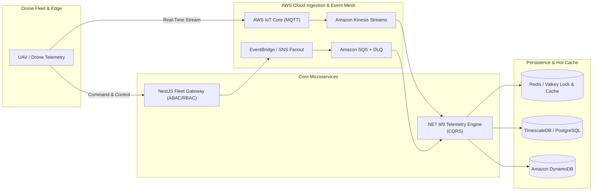
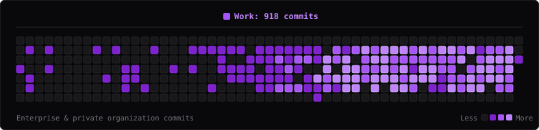

  <!-- Animated Cyberpunk Terminal Header matching v1tor2003-portfolio -->
  

  
I design and ship high-throughput microservices, real-time IoT telemetry pipelines, and idempotent payment systems.

  

    
    
    
    
  

---

### ⚡ What I Build in Production

Most of my commercial code lives in private enterprise repositories, where I architect and maintain distributed backend systems:

- 🚁 **Mid-Level Backend Engineer at GTEEX Revolution (Nov 2025 – Present):**
  Building the distributed backend for a **real-time drone fleet management & command-dispatch platform** in **C# (.NET 8/9)**, **TypeScript (NestJS)**, and **AWS**.
  - Architected live telemetry ingestion pipelines (**AWS IoT Core → Amazon Kinesis → AWS Lambda / TimescaleDB**) handling high-velocity flight data.
  - Engineered decoupled event meshes over **Amazon SQS, SNS & EventBridge** with strict idempotency keys, exponential backoff retries, and **Dead-Letter Queue (DLQ)** redrive policies.
  - Eliminated peak-load concurrency bottlenecks using **Redis / Valkey** distributed locks, **DynamoDB**, and **SQL Server**, deployed via **Docker & AWS ECS** with **CloudWatch** observability.
- 💳 **Tech Lead & Backend .NET Engineer at ClosedFun (Remote, Nov 2024 – Nov 2025):**
  Led backend architecture in **ASP.NET Core (.NET 8)** using **Clean & Vertical Slice Architecture (CQRS)**. Engineered multi-gateway payment and billing pipelines (**Stripe, Mercado Pago, EfiPay**) with idempotent transaction processing, automated financial reconciliation, and **Prometheus + Grafana** monitoring.
- 🧪 **Reliability & Load Engineering:**
  I validate distributed workflows against real containerized dependencies with **Testcontainers**, enforce unit/integration suites in **xUnit / Vitest**, and stress-test p99 latency with **NBomber** and **Artillery**.

<b>📐 Click to expand: Production IoT Telemetry & Event Mesh Architecture (GTEEX Revolution)</b>

 

---

### 🚀 Featured Open-Source & Reference Projects

<table width="100%">
  <tr>
    <td width="50%" valign="top">
      <h4>💳 <a href="https://github.com/v1tor2003/abstract-payments">abstract-payments</a></h4>
      

        
        
        
      

      
Unified C# payment gateway abstraction framework supporting <b>Pix, Stripe, Mercado Pago, and EfiPay</b>. Isolates financial domain logic from provider SDK breaking changes via Strategy/Factory adapters and automated webhook signature verification.

    </td>
    <td width="50%" valign="top">
      <h4>⚡ <a href="https://github.com/v1tor2003/command-api">@v1tor2003/command-api</a></h4>
      

        
        
        
      

      
Lightweight, zero-dependency, transport-agnostic TypeScript HTTP client implementing the <b>Command Pattern</b> with strictly-typed <code>Result&lt;T, E&gt;</code> unwrapping and pluggable test transports.

    </td>
  </tr>
  <tr>
    <td width="50%" valign="top">
      <h4>🎓 <a href="https://github.com/v1tor2003/timeless">timeless</a> & <a href="https://github.com/v1tor2003/sinform-wc-api">sinform-wc-api</a></h4>
      

        
        
      

      
Multi-service Node.js monorepo (HTTP API + file server) and REST architecture foundations built to teach advanced backend engineering workshops at <b>SINFORM 2025 & 2026 (UESC)</b>.

    </td>
    <td width="50%" valign="top">
      <h4>🖥️ <a href="https://v1tor2003-portfolio.vercel.app">Cyberpunk Interactive Portfolio</a></h4>
      

        
        
      

      
Interactive developer portfolio featuring deep-dive architectural case studies from my enterprise work and live Git telemetry.

    </td>
  </tr>
</table>

---

### 🛠️ Production Tech Stack

  

    
  

| Domain | Technologies |
| :--- | :--- |
| **Backend & Runtimes** | `C#` · `.NET 8/9` · `ASP.NET Core` · `TypeScript` · `NestJS` · `Node.js` · `Go` · `Java (Spring Boot)` |
| **AWS & Cloud Infra** | `AWS IoT Core` · `Kinesis` · `SQS & SNS` · `EventBridge` · `ECS` · `Lambda` · `S3 & Glacier` · `SES` · `Docker` · `GitHub Actions` |
| **Data & Distributed State** | `PostgreSQL` · `TimescaleDB` · `SQL Server` · `DynamoDB` · `Redis / Valkey` · `MongoDB` · `Supabase` |
| **Architecture & Quality** | `Clean Architecture` · `Vertical Slice` · `DDD` · `CQRS` · `Testcontainers` · `NBomber` · `Artillery` · `xUnit` · `Vitest` · `Prometheus & Grafana` |

---

### 📈 Enterprise Git Activity

> My personal open-source commits are shown in GitHub's native graph below. This matrix tracks my daily **Enterprise & Private Organization commits** (`@vitor-pires_tecnosul`), synced with [v1tor2003-portfolio.vercel.app](https://v1tor2003-portfolio.vercel.app).

  
    
  

---

### 🤝 Let's Build Together (Remote Roles & Freelance)

I'm finishing my **B.Sc. in Computer Science at UESC** while working as a Mid-Level Backend Engineer, and I'm available for:
- 🌍 **Remote Backend / Cloud Engineering roles** (`.NET`, `TypeScript / NestJS`, `AWS`).
- 🛠️ **Freelance & Consulting projects** — payment gateway integrations (`Stripe`, `Pix`, `Mercado Pago`), event-driven microservices, real-time IoT/messaging pipelines, and backend performance tuning.

  
  
  

