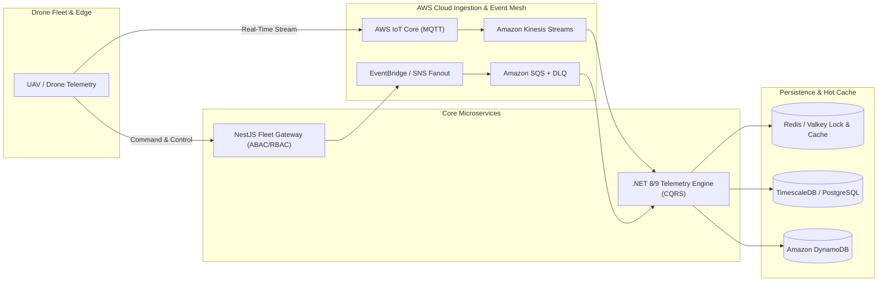

  

  
Computer Science graduate and Backend Software Engineer specializing in high-throughput microservices, event-driven and messaging architectures, cloud infrastructure, observability, and load/integration testing. Open to remote opportunities and freelance projects across backend, cloud, messaging, and system reliability.

  

    
    
    
  

---

### What I Build in Production

Most of my commercial code lives in private enterprise repositories, where I architect and maintain distributed backend systems:

- **Mid-Level Backend Engineer at GTEEX Revolution (Nov 2025 – Present):**
  Building the distributed backend for a **real-time drone fleet management & command-dispatch platform** in **C# (.NET 8/9)**, **TypeScript (NestJS)**, and **AWS**.
  - Architected live telemetry ingestion pipelines (**AWS IoT Core → Amazon Kinesis → AWS Lambda / TimescaleDB**) handling high-velocity flight data.
  - Engineered decoupled event meshes over **Amazon SQS, SNS & EventBridge** with strict idempotency keys, exponential backoff retries, and **Dead-Letter Queue (DLQ)** redrive policies.
  - Eliminated peak-load concurrency bottlenecks using **Redis / Valkey** distributed locks, **DynamoDB**, and **SQL Server**, deployed via **Docker & AWS ECS** with **CloudWatch** observability.

<b>Click to expand: Production IoT Telemetry & Event Mesh Architecture (GTEEX Revolution)</b>

 

---

### Production Tech Stack

  

    
  

| Domain | Technologies |
| :--- | :--- |
| **Backend & Runtimes** | `C#` · `.NET 8/9` · `ASP.NET Core` · `TypeScript` · `NestJS` · `Node.js` · `Java (Spring Boot)` |
| **AWS & Cloud Infra** | `AWS IoT Core` · `Kinesis` · `SQS & SNS` · `EventBridge` · `ECS` · `Lambda` · `S3 & Glacier` · `SES` · `Docker` · `GitHub Actions` |
| **Data & Distributed State** | `PostgreSQL` · `TimescaleDB` · `SQL Server` · `DynamoDB` · `Redis / Valkey` · `MongoDB` · `Supabase` |
| **Architecture & Quality** | `Clean Architecture` · `Vertical Slice` · `DDD` · `CQRS` · `Testcontainers` · `NBomber` · `Artillery` · `xUnit` · `Vitest` · `Prometheus & Grafana` |

---

### Enterprise Git Activity

> Tracks my daily Enterprise & Private Organization commits (`@vitor-pires_tecnosul`), synced with [v1tor2003-portfolio.vercel.app](https://v1tor2003-portfolio.vercel.app).

  

### Personal Git Activity

  

